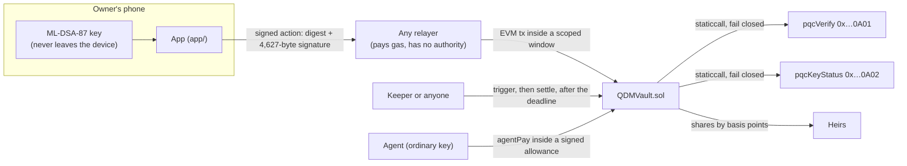

# Heirloom

**Quantum Dead Man's Vault.** A heartbeat inheritance vault on QoreChain. The owner checks in on a schedule. If the owner stops, anyone can trigger the vault after the deadline and the heirs are paid. Every action that moves money or changes the plan needs an ML-DSA-87 (FIPS 204) signature from the owner, verified on-chain through the `pqcVerify` precompile. A leaked classical (secp256k1) key therefore cannot drain the vault, rewrite the heirs or keep the timer from running out.

## At a glance

| | |
|---|---|
| Hackathon | QoreChain Build Before Q-Day, category **Post-Quantum dApp** |
| What it is | An on-chain will with a dead man's switch: check in or your heirs are paid |
| Why QoreChain | The owner's authority is an ML-DSA-87 signature checked in the EVM by the `pqcVerify` precompile, so the vault survives the day secp256k1 keys can be recovered |
| QoreChain features | `pqcVerify`, `pqcKeyStatus`, scoped EVM authorisation windows, hybrid-signed native transactions, `@qorechain/sdk`, `@qorechain/evm` |
| Try it in 2 minutes | `npm ci && npm run build && npm run app:dev`, open the printed address on a phone or desktop, stay in Demo mode |
| Tests | 192 contract tests (6 are Solidity fuzz and invariant tests), 53 simulator tests with real ML-DSA-87, 48 script tests, 49 app tests (342 in total) |
| Testnet | `qorechain-diana`, EVM chain 9800. Addresses are listed under [Testnet deployment](#testnet-deployment) |
| Licence | MIT |

## How Heirloom is different

- **Funds, not secrets.** The vault holds the money and pays it out itself. No seed phrase is ever written down, encrypted or handed over, so there is nothing for an heir, a guardian or a thief to leak.
- **Nobody to trust at the end.** There is no witness and no guardian quorum to approve the payout. Once the deadline passes, anyone can trigger the vault (a keeper earns a small bounty) and the contract pays every heir a fixed share.
- **Every owner action is post-quantum, including the check-in.** Check-ins, withdrawals and plan changes each need a fresh ML-DSA-87 signature verified on chain by `pqcVerify`, bound to a nonce and an expiry. A stolen classical key cannot move funds or even postpone the switch.
- **Attacked on purpose.** The built-in Q-Day drill attacks the vault with the owner's own classical key and shows that nothing moves.



The classical key that sends the transaction is only a courier. The contract never asks who the sender is for an owner action. It asks whether the bytes carry a valid ML-DSA-87 signature over a digest that names this chain, this contract, this vault, this action, these arguments, this nonce and an expiry.

## How it works

The vault is a state machine driven by a heartbeat. Each owner action is also a check-in, so an owner who acts is proof of life.

| State | Meaning | Owner actions | Who can move the vault forward |
|---|---|---|---|
| ALIVE | Last check-in is within the interval | Allowed | Owner, or the agent within its allowance |
| WARNING | Interval has passed, grace period is running | Allowed | Owner |
| OVERDUE | Grace period has passed, nobody has triggered yet | Allowed; any valid owner action resets the clock | Anyone calls `trigger` |
| TRIGGERED | Triggered; owner actions are locked | Not allowed | Anyone calls `settle`; heirs can `claim` |
| SETTLED | Heirs paid; vault is finished | Not allowed | Heirs can `setPayout` and `claim` |
| CLOSED | Owner withdrew everything with `close` | Not allowed | None |

Timing: the heartbeat interval runs from 60 seconds to 365 days (small values are allowed for demos). Grace is 0 to 12 missed intervals.

### Who can do what

| Action | Who submits | Who authorises | Notes |
|---|---|---|---|
| Create a vault | Owner (`createVault`) or anyone (`createVaultFor`) | Owner's ML-DSA-87 key (for `createVaultFor`) | `createVaultFor` lets the owner avoid sending an EVM transaction |
| Deposit native QOR or a token | Anyone | Nobody | Deposits are not check-ins |
| Check in | Anyone (relayer-friendly) | Owner's ML-DSA-87 key | Resets the clock |
| Withdraw | Anyone (relayer-friendly) | Owner's ML-DSA-87 key | Native and up to 4 tokens per vault |
| Set heirs, timing, agent, revoke agent | Anyone (relayer-friendly) | Owner's ML-DSA-87 key | Each one is also a check-in |
| Rotate key (DEVICE mode) | Anyone | Current key, plus proof of possession by the new key | ACCOUNT vaults follow the chain key registry instead |
| Close | Anyone (relayer-friendly) | Owner's ML-DSA-87 key | Withdraws everything to `to` and ends the vault |
| Pay as agent | Agent address only | Owner's earlier allowance | Not a check-in |
| Trigger | Anyone, once overdue | Nobody; the deadline decides | Caller gets a bounty of up to 10% of native balance |
| Settle | Anyone, once triggered | Nobody | Pays heirs by basis points; dust goes to the last heir |
| Claim | Anyone, once settled | Nobody | Pays a heir's credited share to their current payout address |
| Change heir payout address | Anyone | Heir's ML-DSA-87 account key | Allowed while not yet paid |

Owner actions carry an explicit nonce that must equal the vault's nonce, and an expiry. Nonces are strictly sequential, so a relayer cannot reorder two signed actions. Every parameter is inside the signed digest, so a relayer cannot change a recipient, an amount or an heir list.

### Key modes

- **ACCOUNT.** The owner's ML-DSA-87 public key is read live from `pqcKeyStatus(owner)` on QoreChain. The owner must have a registered ML-DSA-87 key with possession proven. The drill sets up one vault in each mode: the ACCOUNT vault shows the chain's own key registry in use and holds 10% of the drill value; the DEVICE vault holds the other 90%.
- **DEVICE.** The vault pins `keccak256(pubkey)` at creation. Creation carries a proof-of-possession signature. Every action passes the 2,592-byte public key in calldata and the contract checks its hash. The key can be rotated with an old-key signature and a new-key proof of possession. The phone app uses this mode, so no mnemonic has to reach the browser.

### Digest

The owner signs a 32-byte digest, and the same 32 bytes are passed to `pqcVerify` as the message:

```
keccak256(abi.encode(TAG, chainid, vault, vaultId, action, keccak256(abi.encode(args)), nonce, expiry))
```

`TAG` is `keccak256("QDMV1")`. The digest binds the chain, the contract address, the vault, the action and its arguments, so a signature cannot be replayed on another chain, another deployment, another vault or another action.

### Agent allowance

The owner can name one agent (a plain ECDSA account) for a vault. The allowance sets:

- one asset (native or one of the vault's tokens),
- a per-payment limit and a per-UTC-day limit,
- an expiry,
- up to 8 payees.

The agent can pay only while the vault is ALIVE. Each refused payment emits an `AgentPayDenied` event with a reason code and does not revert, so refusals are visible on chain. The agent cannot check in, cannot change its own limits, and loses its allowance on trigger, close or revocation. The worst case with a leaked agent key is the daily limit, paid only to allow-listed payees, until the expiry or revocation.

## QoreChain features used

- **`pqcVerify`** at `0x0000000000000000000000000000000000000A01`. Verifies the ML-DSA-87 signature over the digest. Signatures are 4,627 bytes and public keys are 2,592 bytes; both lengths are checked before the call.
- **`pqcKeyStatus`** at `0x0000000000000000000000000000000000000A02`. Returns the registered key for an account, and whether possession of it was proven. The contract requires `possessionProven` and also tolerates the older three-value answer (see Security notes below).
- **Scoped EVM authorisation windows.** A window is opened by a hybrid-signed native message. The deploy and drill tooling opens windows scoped to specific target contracts (`allowed_targets`, up to 16, no contract creation). Our drill account never opens one, and every owner action is relayed.
- **Hybrid signing** through `@qorechain/sdk`, which signs native transactions with both secp256k1 and ML-DSA-87 (`scripts/lib/chain.ts`).
- **`@qorechain/evm`** for window status and cost (`scripts/lib/pure.ts`).

## The Q-Day drill

The drill tests the premise directly. A bot holds only the classical (secp256k1) key of the drill account. It does not hold the ML-DSA-87 key. It tries every drain and stall path it can construct, and the vault's value must not move.

Defences in the contract:

- Every owner action needs a 4,627-byte ML-DSA-87 signature over the exact digest. Calls without one, with a garbage one, with a wrong key, with an expired signature, or as a replay all revert.
- `msg.sender` has no privilege except in `createVault` (which creates a new, empty vault id) and `agentPay` (which requires the agent address; the owner can never be the agent).
- The vault has no `receive` and no `fallback`, and no function that the bot can use to pull value out.
- Deposits are open, because a deposit by the bot only gives the vault money.
- Heirs' payout changes need the heir's own ML-DSA-87 key.
- `trigger` reverts while the deadline has not passed. The drill sets the interval to at least seven days so the vault cannot become OVERDUE during the drill.

Defences at the chain level (QoreChain's own rules, not simulated in this repository): classical-only native transfers and EVM windows are refused by the chain. The drill account holds only fee dust, because all value is deposited in the vault before the drill.

The simulator runs the same attack catalogue on the real contract bytecode and records, for each attack, whether it was rejected, whether it reached the signature verifier, and how much value moved. The drill test asserts that the positive run moves no value and changes no vault state. A negative control runs the same drill with a deliberately broken verifier that accepts every signature. Value does move there, which shows the drill can detect a failure. Scope is contract-level only; the drill report says so.

Drill bot attacks in the catalogue:

- withdraw all native funds, withdraw all tokens, close the vault to the attacker
- make the attacker the sole heir
- stretch the timer to the maximum to starve the heirs; check in; revoke the agent
- install the attacker as an unlimited agent
- replay past signed actions, reuse them on another vault, and submit garbage or truncated signatures
- native transfer, EVM transfer, token approval and drain calls from the drill account
- early trigger, settle and claim before their states are reached

## In-browser demo

`app/` builds to one self-contained HTML file. Demo mode runs the real contract bytecode on a simulated chain (`sim/`). The simulator installs `pqcVerify` and `pqcKeyStatus` as precompiles that verify real ML-DSA-87 signatures (`@noble/post-quantum`). The Hardhat tests use a mock precompile instead, which accepts only signatures the test harness has verified with the same library. The demo includes the drill view.

Hosting: `vercel.json` builds the contracts and the app (`npm run build && npm run app:build`) and serves `app/dist`. Importing the repository on Vercel needs no other settings. Any static host works the same way.

Testnet mode connects through viem to QoreChain testnet (chain 9800) with an injected EIP-1193 wallet. It works only when the page is opened in a wallet browser such as QoreX.

## Repository layout

| Path | Contents |
|---|---|
| `contracts/QDMVault.sol` | The vault contract: all vaults, all actions |
| `contracts/interfaces/` | `IQDMVault.sol` (types, events, errors), `IQorePQC.sol` (precompile interfaces) |
| `contracts/libraries/PQC.sol` | Fail-closed wrappers around both precompiles |
| `contracts/mocks/` | `MockQorePQC` (test precompile), `TestToken`, and two adversarial mocks |
| `contracts/test/QDMVault.t.sol` | Solidity fuzz and invariant tests (forge-std, run by Hardhat 3's Solidity test runner) |
| `test/` | Hardhat 3 tests with viem: digest parity, auth matrix, state machine, settlement, agent, reentrancy, drill, gas report |
| `lib/` | TypeScript shared by tests, scripts and app: digest encoding (`encoding.ts`), ML-DSA-87 helpers (`pq.ts`) |
| `sim/` | Simulated QoreChain (ethereumjs EVM with real precompiles), drill bot, world fixtures |
| `app/` | Vite and React app; Demo and Testnet modes |
| `scripts/` | Testnet deploy, EVM window, PQC probe, drill setup, drill proof, drill verify, keeper |
| `.github/workflows/` | CI, account status, PQC probe, deploy, drill setup, drill proof, drill check-in, drill verify, keeper |
| `docs/` | `DECISIONS.md`, `SPEC.md`, `THREAT_MODEL.md`, `SPEC_CHANGES.md`, `SUBMISSION.md` |

## Run it

Requirements: Node 22 or newer, npm. No network access is needed for the commands below. The testnet workflows need network access and secrets, and run from GitHub Actions.

```bash
npm ci                 # install dependencies
npm run build          # compile the contract (Hardhat 3, solc 0.8.28)
npm test               # Hardhat contract tests
npm run test:sim       # simulator tests with real ML-DSA-87 (drill, precompiles, lifecycle)
npm run app:build      # build the single-file app to app/dist
```

To use the app while developing: `npm run app:dev` serves it (Demo mode needs no wallet and no network). The built file `app/dist/index.html` is self-contained (fonts included) and can be opened directly or hosted anywhere. It opens on the project page; `#/app` opens the vault app directly.

Also available: `npm run typecheck`, `npm run test:scripts`, `npm run typecheck:scripts`, `npm run app:test`, `npm run app:typecheck`.

Test results on Nov 16, 2026: `npm test` 192 passing (186 TypeScript + 6 Solidity fuzz/invariant), `npm run test:sim` 53 passing, `npm run test:scripts` 48 passing, `npm run app:test` 49 passing (several of them drive the React app end to end in a headless DOM on the real in-browser chain: every Demo screen, the briefing, the create flow, the signing moment, the Signature lab, the Q-Day takeover and the persona view; the rest cover the landing page, the adapter and each new screen). Mutation testing by a reviewer: 39 of 42 planted bugs caught before the last round of tests was added; the survivors (two view-only boundaries) now have exact-boundary tests.

## Testnet deployment

Deployment and the Q-Day drill run from GitHub Actions against QoreChain testnet (`qorechain-diana`, EVM chain 9800). The step-by-step guide, the two secrets and the repository variables are in [`scripts/README.md`](scripts/README.md). The order is: fund the deployer (Account status workflow), probe the precompile, CI, deploy, drill setup, drill registration (by Tue Nov 17, 6:59 PM EST), drill proof (during the drill, Nov 18 UTC; paste the hash on the project page by Thu Nov 19), drill verify.

Testnet addresses:

- QDMVault: not deployed yet (filled in after the deploy workflow runs)
- Q-Day Test USD (test token): not deployed yet
- Drill vaults and drill account: set up by the drill-setup workflow
- Proof transaction hash: made during the drill (Nov 18 UTC)

## Security notes and known limits

- **Testnet only.** The `pqcVerify` and `pqcKeyStatus` precompiles exist on QoreChain testnet. On a chain where a precompile is inactive, it returns success with empty data. The contract checks return length and fails closed, so no signed action can pass and nothing can be forged. Funds still reach the heirs through the heartbeat path.
- **Message convention.** The contract passes the 32-byte digest as the raw message with an empty ML-DSA-87 context. This is the convention of QoreChain's own library: `scripts/lib/interop.test.ts` shows that a signature from this repository's signer verifies under `@qorechain/pqc` and is byte-identical to the one that library produces for the same key and digest. The probe workflow (`probe.yml`) then checks the precompile itself on testnet with a fresh key and no funds. Probe result: not run yet; it is the first workflow to run once the repository exists.
- **`pqcKeyStatus` shapes.** QoreChain's precompile documentation gives four return values (`registered, algorithmId, pubkey, possessionProven`; the fourth was added in chain release v3.2.4), while the ABI bundled in `@qorechain/evm` 0.14.0 still lists three. The contract parses the raw answer and accepts both. With four values it requires `possessionProven == true`. A three-value answer cannot prove possession, so `createVault` (which has no signature) reverts `PQKeyPossessionNotProven` on it, and creation goes through `createVaultFor`, which checks an ML-DSA-87 signature against the registry key. The deploy and drill scripts print which shape the testnet returns. Both are covered by tests in `sim/keystatus3.test.ts` and `test/11-keystatus-shapes.test.ts`.
- **ACCOUNT mode trusts the registry.** An ACCOUNT vault follows `pqcKeyStatus(owner)` live. If QoreChain ever let a classical key alone re-register an ML-DSA-87 key, an ACCOUNT vault would follow it. QoreChain's docs say rotating or migrating a key needs signatures from the old and new keys, and a second registration is refused once a key exists. The drill still sets up both modes and keeps 90% of the drill value in the DEVICE vault, which pins the key hash and doesn't depend on that rule.
- **Owner key loss.** An owner who loses the ML-DSA-87 key cannot recover the vault. The heirs receive it after the deadline. That is the design.
- **No admin, no upgrades, no pause.** There is no owner of the contract and no upgrade path. A bug cannot be patched in place; users move to a new deployment with `close`.
- **Tokens.** The vault supports fee-on-transfer tokens. Rebasing tokens are not supported. A hostile token can only harm vaults that listed that token.
- **Heirs.** A failing heir payout does not block settlement. Its share is credited and can be claimed after the heir updates its payout address.
- **Solidity fuzz tests.** `contracts/test/QDMVault.t.sol` uses forge-std (vendored in `lib-sol/`) and runs under Hardhat 3's Solidity test runner as part of `npm test` (256 fuzz runs, 64 invariant runs at depth 50).
- **Audit.** This code has had no external audit. Reviews were done by separate AI agents and are described in [`AI_USAGE.md`](AI_USAGE.md).

Security status, dependency advisories and how to report a problem: [`SECURITY.md`](SECURITY.md). Full threat model: [`docs/THREAT_MODEL.md`](docs/THREAT_MODEL.md). Specification: [`docs/SPEC.md`](docs/SPEC.md). Decisions: [`docs/DECISIONS.md`](docs/DECISIONS.md). Deviations from the spec: [`docs/SPEC_CHANGES.md`](docs/SPEC_CHANGES.md).

## Credits

Built during Build Before Q-Day (November 2026), the QoreChain hackathon in the Post-Quantum dApp category.

This project ports the design, not the code, of Lastword, the author's NEAR Hackathon entry (Dead Man's Wallet, November 2026). Lastword is a heartbeat-triggered estate contract on NEAR.

Libraries and kits:

- OpenZeppelin Contracts 5.1 (`ReentrancyGuard`, `SafeERC20`, `Math`)
- `@noble/post-quantum` 0.7.1 (ML-DSA-87), `@noble/hashes`
- `@ethereumjs/vm`, `evm`, `common`, `util`, `tx`, `statemanager`, `block` (simulated chain)
- viem, Hardhat 3 with the viem toolbox, solc 0.8.28
- React 18, Vite 6, vite-plugin-singlefile
- QoreChain kits: `@qorechain/sdk`, `@qorechain/evm`, `@qorechain/pqc`, and the `create-qorechain-dapp` Hardhat template (its network config and `scripts/window.ts` EVM-window flow were the starting point for `hardhat.config.ts` and `scripts/window.ts`)

Licence: MIT, see [`LICENSE`](LICENSE). AI-assisted development: see [`AI_USAGE.md`](AI_USAGE.md).
